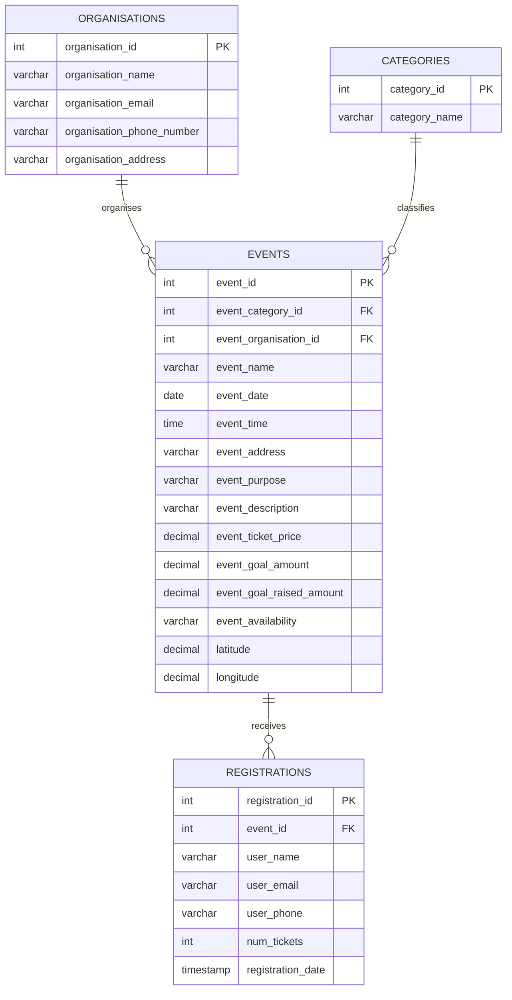
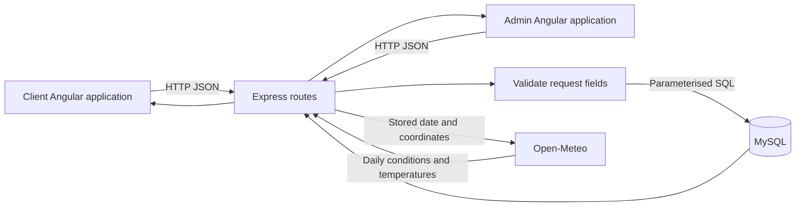
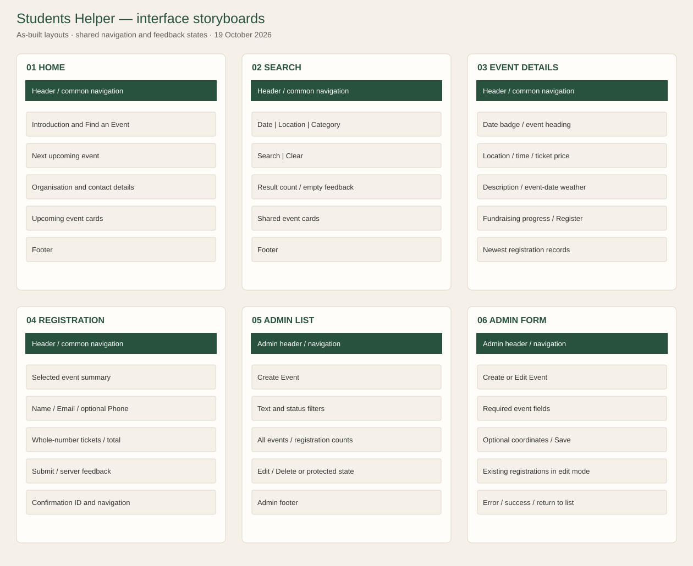

# Students Helper: project design and implementation

This document describes the implemented A3 website. The client builds on the Students Helper case study and the cream and green visual design from A2. Both Angular applications use a single Express API and MySQL database.

## Requirements and implementation

| Requirement | Implementation |
| --- | --- |
| Store event registrations | `registrations` holds the event ID, visitor contact details, ticket count and registration timestamp. |
| One registration per email per event | A composite unique key protects both ordinary and simultaneous requests. The same email can register for other events. |
| Latest registrations on event details | The event response includes registrations ordered by timestamp and ID, descending. |
| Dedicated registration page | `/register/:id` shows the selected event, validates input, displays the total, then confirms the saved registration ID. |
| Full event administration | `/admin/` lists every event, while create and edit routes save through POST and PUT requests. |
| Protect events with attendees | The list explains the protected action; the API checks registrations; the foreign key prevents a conflicting deletion. |
| Common page segments | The client root composes Header, Nav, main content and Footer once. The admin root provides its own shared shell. |
| Angular and TypeScript | Both applications use standalone components, typed API services and Angular routing. |
| Optional external API | The event weather panel requests an event-date forecast through the API. Missing forecasts and provider errors leave registration usable. |

## Database relationships

`UNIQUE(user_email, event_id)` expresses the one-registration rule. `ON DELETE RESTRICT` protects events that have registrations. `CHECK(num_tickets > 0)` prevents a non-positive ticket count at the database level. The dataset contains 10 events and 16 registrations. The date/availability and event/registration-date indexes support the listing queries.

A separate user account table is outside this assessment's required scope. The email identifies a visitor for duplicate checking; the website does not implement user authentication or payments.

## Data flow

The API returns event fields and registrations together for public event details. Administrative reads use a separate endpoint so staff can edit suspended and past events. Event creation and updates validate text lengths, calendar dates, clock times, monetary precision, category IDs, availability and optional coordinates before querying MySQL.

The public list, search and registration checks all use the current `Australia/Brisbane` calendar date, supplied as a SQL parameter. A server or database in another time zone therefore uses the same event day as the public and admin pages. The registration insert rechecks availability and the current Brisbane date inside `INSERT ... SELECT`. A unique database constraint handles simultaneous duplicates. Deletion also catches the foreign-key error if a registration arrives after the initial count check.

## Interface storyboards

These wireframes document the completed pages and their loading, error and confirmation states.

| Screen | Interaction and feedback |
| --- | --- |
| Home | Shared navigation, introduction and contact details, next event, upcoming event cards. Loading, error/retry and empty states. |
| Search | Date, location and category fields; matching event cards; filters preserved in the URL; browser Back restores the previous search. Separate category-loading error. |
| Event details | Event date, location, price, description, fundraising progress, weather and newest registrations. Register links to the selected event. |
| Registration | Event summary, name/email/optional phone/tickets, calculated total. Required and whole-number validation, submission progress, server error or confirmation with a reference ID. |
| Admin list | Complete event list, text/status filters, registration counts and edit actions. Delete protection is explained on registered events. |
| Admin form | Reused create/edit form. Edit preloads event details and registrations. Descriptions accept paragraphs. A successful save stays locked until the list opens. Optional coordinate pair enables the forecast. Errors preserve entered data. |

## Accessibility and consistency

The client has a skip link, labelled controls, active navigation state, visible focus indicators and status/error announcements. Registration confirmation receives focus after saving. Tables have column headings and horizontal scrolling containers. Forms and the shared card grid adapt to narrow screens. Reduced-motion preferences disable decorative transitions.

The shared `EventCard` prevents the home and search listings from drifting apart. Formatting helpers keep SQL calendar dates on the displayed day and use the same date/time and money presentation across public pages. Server responses are represented by TypeScript interfaces.

## Weather integration

The API uses coordinates stored on the event, requests the event date in Queensland time, and translates numeric weather codes into readable descriptions. A forecast outside the provider's 16-day horizon is explained rather than replaced with today's conditions. Missing coordinates, incomplete provider data, timeouts and HTTP failures have distinct handling. The weather panel makes its own request so failure does not hide event details.

Reference: [Open-Meteo forecast API documentation](https://open-meteo.com/en/docs).

## Verification and deployment

The [verification record](verification.md) covers local production builds, API checks and browser interactions. Temporary test records were removed, and the original event and registration rows were compared before and after those local checks. Each student's school deployment is verified separately.

Each student must deploy to their own school account. Credentials belong in a server-side ignored file or environment variables. The public client, admin deep links, API reads and actual create/update/registration/delete behaviour must be checked on the deployed site before the final submission.
